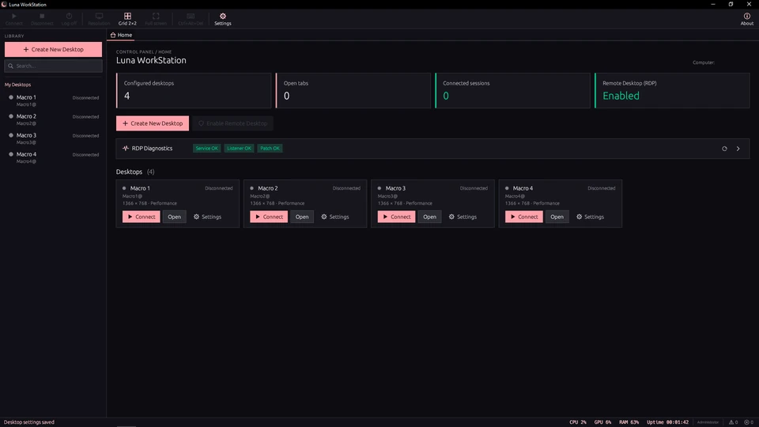
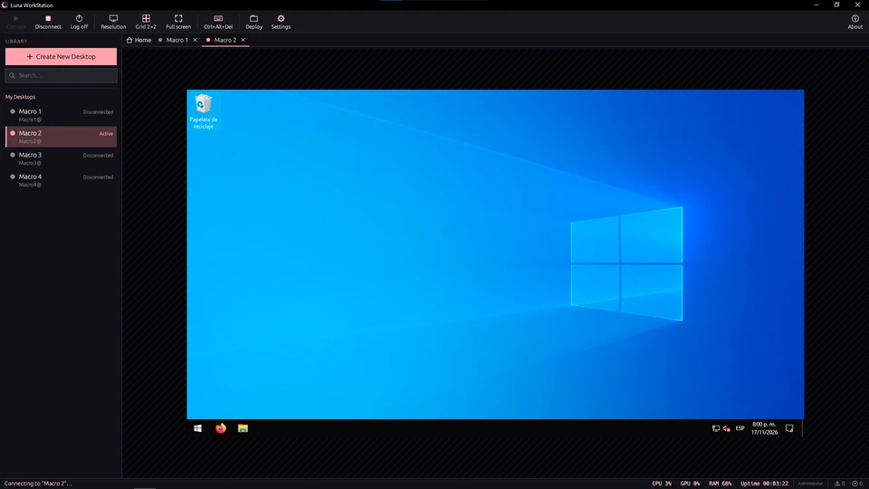
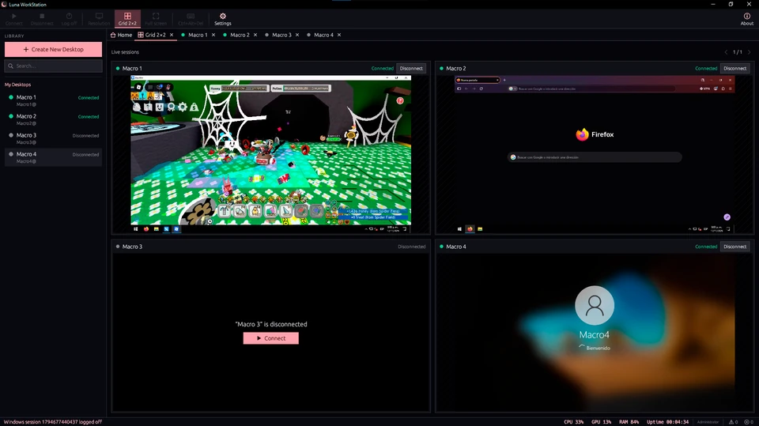
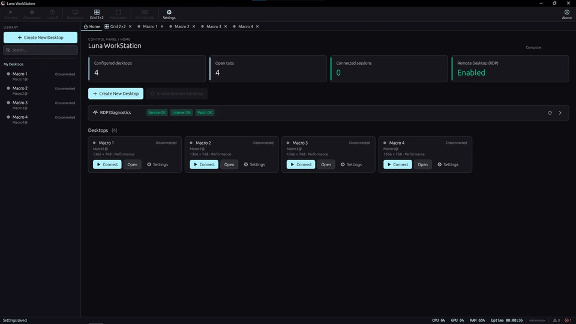

# Luna WorkStation

**Local Remote Desktop sessions, side by side in one window.**

Luna WorkStation is a free desktop application for Windows that runs several local Remote Desktop sessions on the
same computer and shows each one in its own tab, using the Remote Desktop control built into Windows. It can create
the Windows accounts used by each desktop and automate what happens when a desktop connects.

- **Current version:** 1.0.0
- **Platform:** Windows (64-bit)
- **Website:** https://korikashi.github.io/Luna-Workstation-Releases/
  <!-- Replace with https://luna-workstation.korikashi.uk/ once the custom domain is active. -->

## Download

[**Download LunaWorkstation-setup.exe**](https://github.com/Korikashi/Luna-WorkStation-Releases/releases/latest/download/LunaWorkstation-setup.exe)

This link always points to the installer of the latest release. Release notes and the `SHA256SUMS.txt` checksums are
on the [Releases](https://github.com/Korikashi/Luna-WorkStation-Releases/releases) page.

## Screenshots

| Home | Active session |
| --- | --- |
|  |  |
| **Grid 2×2** | **Personalization** |
|  |  |

## Features

- **Local desktops in tabs:** each desktop is a Remote Desktop session on this computer, embedded in its own tab.
- **Grid 2×2:** view up to four live sessions at once and return to the previous tab with one click.
- **Full screen, resolution and Ctrl+Alt+Del** from the toolbar.
- **Desktop library and Home:** create, search, pin and reorder desktops; see the Remote Desktop status and enable it.
- **Windows account management:** create local accounts for each desktop and add them to Remote Desktop Users, with
  optional administrator rights; changes to existing accounts are listed before they are applied and then verified.
- **Disconnect or log off:** keep a Windows session running in the background or end it. Luna only acts on the exact
  session that belongs to each tab.
- **Per-desktop settings:** name, audio, resolution and graphics mode (Quality or Performance).
- **Automation with AutoHotkey v2 (included):** launch programs when a desktop connects, scheduled session restarts,
  reconnection after unexpected disconnections and a Roblox frame-rate cap.
- **Folders and files:** deploy local folder templates to any desktop at a relative path.
- **Appearance:** dark theme, six accent presets or a custom color, Windows 10 or Windows 11 border style, English
  and Spanish.
- **System monitor and Discord Rich Presence** (optional).
- **Built-in updates:** new versions are checked on the official Releases, verified with SHA-256 and installed while
  keeping your settings, desktops and profiles.
- **Resource limits (experimental):** memory and CPU-core limits per desktop with Windows Job Objects, off by default.

Only local targets are allowed (loopback addresses 127.0.0.2 to 127.0.0.254). Desktop passwords are encrypted with
Windows DPAPI and never written to logs.

## Requirements

- 64-bit Windows (the installer stops on 32-bit systems).
- An account with administrator rights: the installer requires it and Luna asks for administrator permissions (UAC)
  every time it starts.
- The Remote Desktop components included with Windows (`mstscax.dll`, `atl.dll`) and the Remote Desktop service of
  the computer (Luna can enable it from its Home page).
- Luna must be started from a local session: it does not start inside a Remote Desktop session, and only one
  instance can run on the computer at a time.

## Installation

1. Download `LunaWorkstation-setup.exe`.
2. Run it, choose English or Spanish and accept the license agreement.
3. Choose the shortcuts and the installation folder (by default `Program Files\Luna WorkStation`).

Uninstall from **Installed apps** in Windows. Uninstalling keeps your settings and desktops and never deletes the
Windows accounts created or managed with Luna.

## Support and contact

- Email: [kori.LunaWorkStation@gmail.com](mailto:kori.LunaWorkStation@gmail.com)
- When reporting a problem, include your Windows version, the Luna version (Settings → About) and, if possible, the
  relevant lines of `%APPDATA%\LunaWorkstation\debug.log`. Review the log before sharing it.

## Support the project

Luna WorkStation is free. If it is useful to you, you can support its development on
[Ko-fi](https://ko-fi.com/korikashi).

## License

Luna WorkStation is free of charge for personal and commercial use and is distributed under a proprietary license
(EULA) shown during installation. It is not open source and its source code is not published in this repository.

The installer includes [AutoHotkey](https://www.autohotkey.com/) v2, distributed under the GNU General Public
License v2.0, unmodified and run as a separate process. Its license and notices are installed with Luna WorkStation,
and the corresponding source code is attached to each release as
[`AutoHotkey_2.0.31_source.zip`](https://github.com/Korikashi/Luna-WorkStation-Releases/releases/latest/download/AutoHotkey_2.0.31_source.zip)
(official archive of AutoHotkey tag `v2.0.31`).

Windows and Remote Desktop are trademarks of Microsoft. Roblox is a trademark of Roblox Corporation. This project is
not affiliated with Microsoft, Roblox or Discord.

---

## Español

**Luna WorkStation** es una aplicación gratuita de escritorio para Windows que ejecuta varias sesiones de Escritorio
remoto locales en el mismo equipo y muestra cada una en su propia pestaña, con el control de Escritorio remoto
integrado en Windows. Puede crear las cuentas de Windows que usa cada escritorio y automatizar lo que ocurre al
conectarse.

- **Versión actual:** 1.0.0 · **Plataforma:** Windows de 64 bits
- **Descarga:** [LunaWorkstation-setup.exe](https://github.com/Korikashi/Luna-WorkStation-Releases/releases/latest/download/LunaWorkstation-setup.exe)
- **Requisitos:** Windows de 64 bits, cuenta de administrador, componentes de Escritorio remoto de Windows; Luna se
  inicia desde una sesión local (no dentro de una sesión de Escritorio remoto) y solo admite una instancia por equipo.
- **Instalación:** ejecuta el instalador, elige español o inglés y acepta el contrato de licencia. La desinstalación
  conserva la configuración, los escritorios y las cuentas de Windows.
- **Contacto:** [kori.LunaWorkStation@gmail.com](mailto:kori.LunaWorkStation@gmail.com)
- **Donaciones:** [Ko-fi](https://ko-fi.com/korikashi)
- **Licencia:** gratuita para uso personal y comercial, con licencia propietaria (EULA). Incluye AutoHotkey v2
  (GPL-2.0) sin modificar; su código fuente está en cada Release como
  [`AutoHotkey_2.0.31_source.zip`](https://github.com/Korikashi/Luna-WorkStation-Releases/releases/latest/download/AutoHotkey_2.0.31_source.zip).
